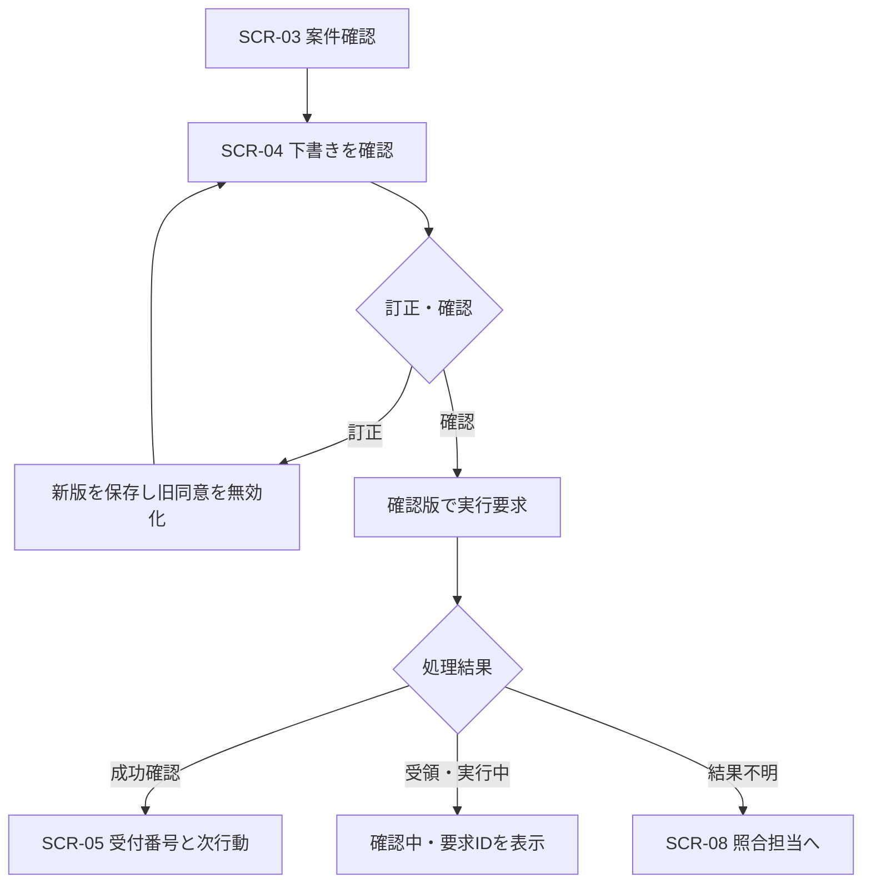

# EXT-001　外部設計書（基本設計）

[文書一覧](README.md)｜[ケースブック](../BOOK.md)｜[要件追跡表](07-traceability.md)

| 管理項目 | 内容 |
| --- | --- |
| 案件名 | コントソ家電 アフターサービス業務改善 |
| 文書番号・版 | EXT-001 / 1.0 |
| 編集基準日 | 2026年10月25日 |
| 作成責任 | 小林航 |
| レビュー責任 | 高橋隆、森彩、岡本葵 |
| 本ケースでの承認責任 | 業務責任：松田恵理／技術責任：岡本葵 |
| 基準となる工程 | 3月13日の方式・業務設計審査と受入時の業務仕様 |
| 文書の位置付け | ケースブックと整合する学習用の設計成果物。実案件の署名・承認や実機検証の実施を証明するものではない |

本書の会社・人物・データは架空である。本文で決めた業務条件を設計書として具体化し、画面ID・処理ID・制約・試験条件を補っている。追加した設計値も本ケースの仕様であり、製品既定値や実在企業の規程ではない。

## 文書管理

| 版 | 変更内容 | 変更時に合わせて確認するもの |
| --- | --- | --- |
| 1.0 | 完成版ケースブックを基準に成果物化 | 要件、外部設計、内部設計、試験、移行、運用、用語・IDの整合 |

変更はCR番号で起票し、影響する要件ID・画面ID・処理ID・試験IDを追記する。過去の承認済み版を上書きして承認の根拠を消さない。

## 1. 目的と設計境界

利用者から見える入出力、画面遷移、業務上の状態、他システムとの契約を定義する。テーブルの排他制御や再試行の詳細は[内部設計書](03-internal-design.md)で定義する。


| 境界ID | 利用者・入口 | 利用できる情報・処理 | 持たせない権限 |
| --- | --- | --- | --- |
| EXT-BND-01 | 公開Web一般案内 | 公開FAQ、対象機の公開説明書、保護された受付への移動 | 社員接続、社内文書、個別注文・更新ツール |
| EXT-BND-02 | 保護された既存受付 | 本人・対象確認、連絡先、希望の受付 | フォーム受領による費用・予約の確約 |
| EXT-BND-03 | 社員Teams | 担当案件、社内支援、確認付きの実行 | モデル出力のuserIdによる権限拡大 |
| EXT-BND-04 | 協力会社の既存業務画面 | 割当訪問の必要情報、診断・作業報告 | 全顧客検索、社内補償メモ |

## 2. 機能一覧と完了条件

| 機能ID | 機能 | 利用者が確認できる完了 | 関連要件 |
| --- | --- | --- | --- |
| EXT-F-01 | 根拠付き一次回答 | 対象・根拠・留保・次行動が分かる | R-01・10・11 |
| EXT-F-02 | 保証材料の照会 | 契約提供者、期間、診断待ち等を区別 | R-02・03 |
| EXT-F-03 | 修理相談の受付 | 確認した版の登録結果と受付番号を取得。予約は別 | R-05・06・08 |
| EXT-F-04 | 既存案件・進捗照会 | 対象番号、正本の取得時刻、次担当・期限 | R-02・08 |
| EXT-F-05 | 見積・承認・同意 | 現行版の金額と負担、承認結果、顧客同意 | R-03・07・09 |
| EXT-F-06 | 部品照会・引当 | 適合と引当IDを確認。単なる可用数表示は未成立 | R-09 |
| EXT-F-07 | 引継ぎ・例外対応 | 引受け確認。未引受けは送り手の一覧に残る | R-04・08・10 |
| EXT-F-08 | 結果不明・縮退 | 再登録を止め、担当・照合時刻・代替手段を表示 | R-05・12 |
| EXT-F-09 | 公開・運用・計測 | 承認した構成版、対象範囲、期限、再計算可能な指標 | R-13～16 |

## 3. 画面一覧

画面は論理画面であり、Teamsカード・既存画面・フォームのどこへ配置しても以下の意味を保つ。

| 画面ID | 名称・利用者 | 主な項目 | 主な操作・遷移 |
| --- | --- | --- | --- |
| SCR-01 | 公開一般案内／顧客 | 用件、型番、公開根拠、注意事項 | 追加確認、根拠を開く、SCR-02へ |
| SCR-02 | 保護された受付／顧客・受付 | 対象確認、連絡先、症状、希望、同意 | 受付希望の送信。個別照会の本人確認と登録成功は別 |
| SCR-03 | 案件ワークスペース／受付 | Case、確認済み／未確認、保証段階、次担当、期限 | 照会、下書き、引継ぎ、SCR-04へ |
| SCR-04 | 実行前確認／受付 | 対象、連絡先、症状、希望枠、処理内容、版 | 項目訂正、実行確認、中止 |
| SCR-05 | 受付・処理結果／受付 | 要求ID、処理状態、受付番号、予約状態、次行動 | 結果照会、案件へ戻る、結果不明を引継ぐ |
| SCR-06 | 引継ぎ・滞留一覧／SV | 担当、未引受け時間、期限、理由、次行動 | 割当、引受け確認、督促、SCR-03へ |
| SCR-07 | 見積・承認／権限担当 | 明細、料金版、税、負担、見積版、期限 | 承認依頼、審査、差戻し、交付・同意記録 |
| SCR-08 | 実行照合一覧／運用 | requestId、外部ID、状態、最終照合、担当 | 外部照合、関連付け回復、保留、再開審査 |
| SCR-09 | 効果・品質集計／管理者 | 案件・接触・工数・未判定・費用 | 対象期間と定義を確認し、許可範囲で原票へ |

### SCR-04 入出力定義


| 項目 | 必須条件 | 表示・検証 | 訂正時の影響 |
| --- | --- | --- | --- |
| Case・対象製品 | 必須 | RF0006とCT-RF455V、製造番号を区別 | 対象変更は保証・適合を再確認 |
| 連絡先 | 折返し受付に必須 | 保護領域の参照から表示。公開会話へ自動転載しない | 版更新・再確認 |
| 症状 | 必須 | 申告事実。診断名は別 | 危険兆候なら通常処理を中断 |
| 希望枠 | 任意 | 希望であって予約確定ではないことを併記 | 予約の正本は直接書き換えない |
| 保証状態 | 必須 | 期間内／診断待ち等を別表示 | 費用未確定を隠さない |
| 実行する手続き | 必須 | 「修理相談を登録」。料金決済や訪問確定を含めない | 手続き変更は別の同意 |
| 下書き版 | 必須・編集不可 | 確認対象のv3等を保持 | v2の同意はv3へ流用不可 |

### 画面遷移と確約の境界



ボタンを連打しても新しい要求IDを生成しない。中止は未送信の下書きを止める操作であり、成立済み予約・引当の解除は別の取消手続きである。

## 4. 一次回答・保証・安全の業務設計

一次回答は[付録Aの五分類・七項目](../BOOK.md#appendix-A)を仕様とする。一回の質問は必要な1～2項目を優先する。用件が修理・保証・訪問希望にまたがる場合は全用件を保持し、一つへ分類して他を捨てない。

| 判定 | 表示する内容 | 禁止する結論 |
| --- | --- | --- |
| 期間内・診断待ち | 期間内である根拠、診断後に適用確認、次の手続き | 無償確定 |
| 証憑不足・注文該当なし | 確認が必要、代替証憑、販売店窓口 | 保証無効・未購入 |
| 受付登録成功 | 修理受付番号、担当、次の連絡 | 今日の訪問確定 |
| 引継ぎ送信のみ | 送信済み・未引受け、追跡担当 | 対応完了 |
| 外部結果不明 | 確認中、再登録しない、次回連絡 | 登録失敗だから再実行 |

危険兆候では通常の会話を止め、承認済みの安全案内へ移る。事故原因、補償、再使用の可否をAIの推測で決めない。

## 5. 外部インタフェース一覧

| IF-ID | 相手・正本 | 方向・処理 | 主な責任分界 |
| --- | --- | --- | --- |
| IF-01 | 受注・保証契約 | 参照：GetWarrantyEvidence | 購入と契約の材料を返す。現地診断・適用確定は別 |
| IF-02 | 手配システム | 更新：CreateRepairRequest、結果照会 | 登録の一意性、受付ID、対象認可、結果照合 |
| IF-03 | 在庫システム | 参照・更新：GetPartAvailability、ReservePart | 適合と数量、原子的引当、期限、解除 |
| IF-04 | 料金・承認 | BuildQuoteDraft、RequestApproval | 料金版、税、対象見積版、決定・期限 |
| IF-05 | 訪問予約 | 確定枠参照・担当者による更新 | 希望と確定を区別。自動最適化は初期対象外 |
| IF-06 | 完成品生産画面 | 読取RPA：GetProductionStatus | 対象一致、画面変更、0件・複数件の停止 |
| IF-07 | 通知・引継ぎ | 連絡・受領確認 | 送信と引受けを別管理。失敗した通知だけ回復 |

### 入出力・状態・エラー契約

[第8章](../BOOK.md#chapter-8)の連携を、入出力・状態・異常時の責任で定義する。ここに示す契約は実装するAPIやフローが満たすべき論理仕様である。モデルが生成したuserIdやisAdminを信頼せず、認証済みの接続からサーバーが実行主体を決める。

### D-1　共通契約

**全ツールに共通する条件**

| 観点 | 仕様 |
| --- | --- |
| 呼出し境界 | 公開一般案内には個別照会・更新ツールを登録しない。内部でも対象への認可を検証 |
| 参照結果 | 対象キー、正本、取得時刻、状態、必要な根拠を返す |
| 更新要求 | 要求ID、確認した版、同意参照を入力。サーバーが下書きを取得して検証 |
| 一意性 | 同じ要求ID＋同じ内容は既存結果。同じID＋別内容は拒否 |
| 応答の意味 | ACCEPTEDは処理受領。SUCCEEDEDは当該操作の正本で成功確認済み |
| 結果不明 | UNKNOWNで保存し、照会・照合を行う。新しい要求IDで自動再登録しない |
| 監査 | 相関ID、実行主体、対象、版、結果、外部ID。秘密や不要な会話全文は記録しない |

### D-2　ツールごとの入出力

**GetWarrantyEvidence／保証の材料**

| 欄 | 定義 |
| --- | --- |
| 目的 | 対象契約と期間の材料を取得。原因診断と適用確定は行わない |
| 入力 | caseId、installedProductId、orderId |
| 事前条件 | 案件アクセス、所有機と注文の関連を接続先で検証 |
| 成功 | FOUND、商品・型番、購入日、提供者、契約、満了日、periodStatus、coverageStatus、取得時刻 |
| 例 | RF0006、CT-RF455V、2025-10-05、CT-WAR-2025-01、2030-10-04、IN_PERIOD、PENDING_DIAGNOSIS |
| 他の状態 | NOT_FOUND・NEEDS_CHECK・FORBIDDEN・UNAVAILABLE。どれも保証無効を意味しない |

**CreateRepairRequest／修理受付登録**

| 欄 | 定義 |
| --- | --- |
| 目的 | 確認済み下書きで手配システムに修理相談を登録。訪問枠は確定しない |
| 入力 | requestId、caseId、draftId、draftVersion、consentRef |
| 事前条件 | 認可、下書き版、同意対象、有効性、一意性を検証 |
| 受領のみ | ACCEPTED、requestId。受付番号と予約を確約しない |
| 成功確認後 | SUCCEEDED、requestId、repairRequestId、bookingStatus、ownerTeam、nextAction、取得時刻 |
| 異常 | 版違いは再確認。外部結果不明はUNKNOWNで照合。入力違いで同じIDは拒否 |

以下は、外部登録と台帳への関連付けの成功を確認した応答例である。成功したのは修理相談の登録で、訪問予約の成立ではない。

```json
{
  "status": "SUCCEEDED",
  "requestId": "REQ-DEMO-0042-REPAIR-01",
  "repairRequestId": "R-260715-0421",
  "bookingStatus": "NOT_CONFIRMED",
  "ownerTeam": "関西手配窓口",
  "nextAction": "訪問候補の調整",
  "retrievedAt": "2026-07-15T10:40:00+09:00"
}
```

**GetExecutionResult／実行結果照会**

| 欄 | 定義 |
| --- | --- |
| 入力 | requestId。対象案件の認可を確認 |
| 結果 | NOT_STARTED・RUNNING・SUCCEEDED・FAILED・UNKNOWN |
| NOT_STARTEDの条件 | 正本で要求未受理・未実行を確認できること。検索反映前の0件では不可 |
| UNKNOWNの処置 | 照合担当とnextCheckAtを設定。接続先と台帳が一致するまで保留 |
| 完了 | 外部ID、結果状態、関連台帳、必要な通知の整合を確認 |

**GetPartAvailabilityとReservePart／部品照会・引当**

| 欄 | 定義 |
| --- | --- |
| 照会入力 | partId、warehouseId、適合版 |
| 照会結果 | 実在庫、既引当、可用数、適合情報、取得時刻。数量は個 |
| 引当入力 | requestId、caseId、partId、warehouseId、正の整数quantity |
| 引当制御 | 在庫側で原子的に確認・更新。同時の最後の一個は一件だけ成功 |
| 結果 | RESERVED・INSUFFICIENT_STOCK・INCOMPATIBLE・UNKNOWN。成功は引当IDと保持期限を伴う |
| 取消 | 解除要求と解除完了を別記録にし、解除失敗を放置しない |

**BuildQuoteDraftとRequestApproval／見積・承認**

| 欄 | 定義 |
| --- | --- |
| 見積入力 | 確定部品、数量、作業区分、料金マスタ版、税区分、費用負担者 |
| 計算 | 明細、税抜合計、税、総額、顧客負担をルールで計算。AIは説明文を支援 |
| 例 | 8,000＋9,000＋4,000＝21,000円、税2,100円、税込23,100円。保証適用の主案件は顧客0円 |
| 承認要求 | 案件、見積ID、見積版、承認種別、期限を固定 |
| 受領後 | 承認要求IDを返す。決定取得と現行版照合が済むまで承認待ち |
| 標準と例外 | 標準保証の委譲範囲と例外承認を分ける。必要な顧客同意は別に確認 |

**GetProductionStatus／完成品生産照会**

| 欄 | 定義 |
| --- | --- |
| 入力 | 完成品の製品番号。修理部品の引当・予約には使用しない |
| 成功 | 照合した製品番号、製造指示番号、計画完了日、状態、取得時刻 |
| 事前検査 | 専用端末、アプリ、画面ラベル、対象番号、出力形式 |
| 失敗 | NO_MATCH・MULTIPLE_MATCHES・UI_CHANGED・TIMEOUT |
| 回復 | 読取りと画面状態を確認して回数制限付き再試行。推測選択をしない |

### D-3　業務状態への翻訳

**内部エラーと利用者の次の行動**

| 内部状態 | 表示・後続処理 |
| --- | --- |
| VALIDATION_ERROR | 不足・不整合の項目だけを聞き直す |
| FORBIDDEN | 内容を開示せず、権限ある窓口へ。対象の存在を漏らさない |
| VERSION_CONFLICT | 最新内容を再取得し、変わった項目を確認 |
| DEPENDENCY_UNAVAILABLE | 代替業務と次の連絡予定を示す |
| RESULT_UNKNOWN | 同じ要求を照会し、再登録を抑止 |
| APPROVAL_PENDING | 承認待ち、担当、期限を表示 |
| APPROVAL_EXPIRED | 期限切れで担当へ戻し、古い要求を再利用しない |

自由文の返却を統合する場合も、status、missingFields、evidence、nextActionを構造化する。保証のNEEDS_CHECKを「保証対象外」のような強い結論へ要約してはならない。親側は各結果の確度と取得時点を保ったまま利用者へ説明する。
## 6. 帳票・通知設計

| 帳票ID | 出力・対象 | 必須内容 | 発行条件 |
| --- | --- | --- | --- |
| RPT-01 | 修理相談の登録結果／顧客 | 受付番号、対象機、担当、次行動、取得時刻、予約未確定 | 正本で受付成功を確認 |
| RPT-02 | 引継ぎ票／受け手 | 確認済み・未確認・試した操作・希望・理由・期限 | 対象範囲の認可を確認 |
| RPT-03 | 見積書／顧客 | 対象機、明細、税、総額、顧客負担、版、有効期限 | 必要な承認と現行版が一致。初期版は担当が交付 |
| RPT-04 | 結果不明一覧／運用 | 要求ID、処理名、外部ID、担当、次回照合、経過 | Unknownまたは台帳不一致 |
| RPT-05 | 月次効果報告／経営 | 分母、除外、追跡期間、有人工数、現金効果、残課題 | 集計版を確定し元データと照合 |

全帳票で住所・電話・購入証明を必要な相手にだけ表示する。メールの件名や監視通知へ個人情報全文を載せない。顧客へ見せる目安は、社内SLOをそのまま一律確約に転記しない。

## 7. 権限と外部設計の受入

役割だけでなく、担当案件・割当訪問・業務目的を評価する。公開利用者は個別ツールへ到達しない。受付は診断や費用例外を確定せず、倉庫は不要な顧客対応メモを編集しない。品質保証は規約例外を判断し、監査記録を改変できない。

受入ではSCR-04の訂正、SCR-05の確認中／成功の区別、SCR-06の未引受け、SCR-08の結果不明を実利用者権限で確認する。正常画面の見た目だけで合格にしない。
