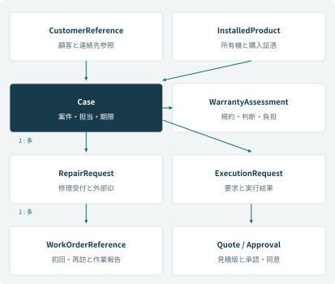
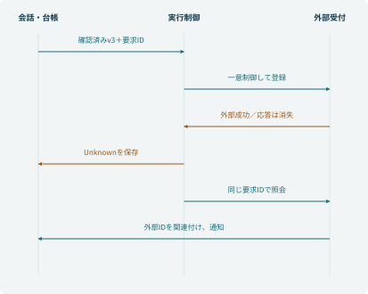
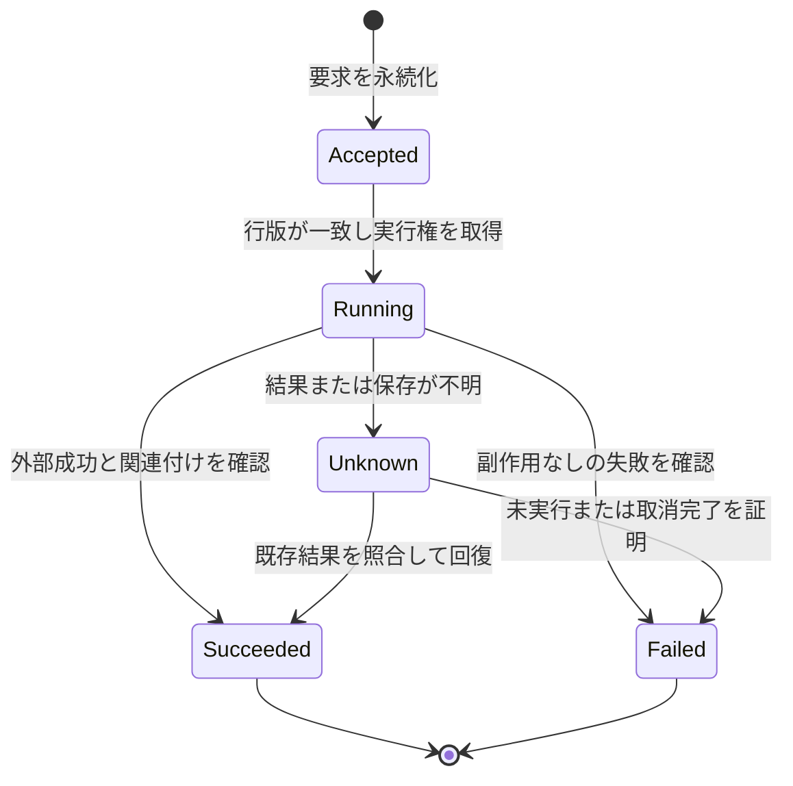

# INT-001　内部設計書（詳細設計）

[文書一覧](README.md)｜[ケースブック](../BOOK.md)｜[要件追跡表](07-traceability.md)

| 管理項目 | 内容 |
| --- | --- |
| 案件名 | コントソ家電 アフターサービス業務改善 |
| 文書番号・版 | INT-001 / 1.0 |
| 編集基準日 | 2026年10月25日 |
| 作成責任 | 小林航・実装担当 |
| レビュー責任 | 岡本葵／IT、青木莉子／品質担当 |
| 本ケースでの承認責任 | 岡本葵／IT |
| 基準となる工程 | 実装開始前の処理・データ設計と結合試験の判定基準 |
| 文書の位置付け | ケースブックと整合する学習用の設計成果物。実案件の署名・承認や実機検証の実施を証明するものではない |

本書の会社・人物・データは架空である。本文で決めた業務条件を設計書として具体化し、画面ID・処理ID・制約・試験条件を補っている。追加した設計値も本ケースの仕様であり、製品既定値や実在企業の規程ではない。

## 文書管理

| 版 | 変更内容 | 変更時に合わせて確認するもの |
| --- | --- | --- |
| 1.0 | 完成版ケースブックを基準に成果物化 | 要件、外部設計、内部設計、試験、移行、運用、用語・IDの整合 |

変更はCR番号で起票し、影響する要件ID・画面ID・処理ID・試験IDを追記する。過去の承認済み版を上書きして承認の根拠を消さない。

## 1. 構成要素と内部処理ID

| 処理ID | 責務 | 入力 | 出力・更新 |
| --- | --- | --- | --- |
| INT-P01 | 根拠の検索・用件整理 | 機種、用件、公開区分、対象日 | 根拠ID・版、不足項目、回答候補 |
| INT-P02 | 実行主体・対象認可 | 認証済み主体、操作、対象 | 許可／拒否、監査用の判定理由 |
| INT-P03 | 保証の段階判定 | 契約、証憑、期間、診断、規約版 | WarrantyAssessment |
| INT-P04 | 確認下書き・同意の固定 | 入力値、下書き版、確認行為 | 新版下書き、CustomerConsent |
| INT-P05 | 修理受付の一意実行 | requestId、確認済み版 | ExecutionRequest、外部受付との関連 |
| INT-P06 | 引当・費用・承認制御 | 適合、数量、料金版、対象見積版 | 引当参照、Quote、Approval |
| INT-P07 | 引継ぎと期限 | 受渡し内容、受け手、営業日 | Handover、Task、期限 |
| INT-P08 | 結果不明の照合・再開 | 要求ID、外部ID、実行履歴 | 回復結果、残タスク、次回照合 |
| INT-P09 | RPA読取り | 完成品ID、許可された画面 | 対象一致した生産情報または明示的失敗 |
| INT-P10 | イベントと集計 | 案件・接触・要求・費用 | 版管理した日次・月次集計 |
| INT-P11 | 構成管理・配備 | 承認した構成版、接続参照 | 配備証跡、切戻し可能な前版 |

Copilot Studioは会話・選択を担い、確定値の検証と認可は実行側で行う。Power Automateは待機・分岐・通知を担う。フローの同時実行設定だけを、外部システムまで含めた一意性の保証として扱わない。

## 2. 論理データモデル・項目定義

[第6章](../BOOK.md#chapter-6)の論理モデルを項目へ展開する。内部主キーはUUID等の不変キーとし、C-…やR-…の表示番号には別途一意制約を置く。以下は主要項目の論理定義であり、外部システムの正本を台帳へ全面複製する設計ではない。

### C-1　顧客・所有機

**CustomerReference／顧客参照**

| 項目・型 | 意味と制約 |
| --- | --- |
| customerRef／識別子 | 不変キー。氏名の一致で統合しない |
| contactRef／参照 | 保護された連絡先への参照。住所・電話の重複保存を避ける |
| verificationStatus／選択肢 | 未確認・確認済み・再確認必要 |
| verifiedAt、verificationMethod／日時・選択肢 | 本人・対象を確認した日時と方法。APIの認証・認可を代替しない |

**InstalledProduct／所有製品**

| 項目・型 | 意味と制約 |
| --- | --- |
| installedProductId／識別子 | 所有機を一意に表す |
| customerRef／参照 | 顧客との関連。名義・所有者の変更は履歴を残す |
| productId、modelNumber／参照・文字列 | 商品マスタと型番。RF0006とCT-RF455Vを混同しない |
| serialNumber／文字列 | 製造番号。適合範囲と複数所有を区別 |
| purchaseDate、purchaseEvidenceRef／日付・参照 | 確認済み購入日と根拠 |
| candidatePurchaseDate／文字列 | 「昨年秋」等の申告候補。確定日へ自動転記しない |

### C-2　案件・修理・訪問

**Case／顧客案件**

| 項目・型 | 意味と制約 |
| --- | --- |
| caseId／表示番号 | 例C-260715-0042。内部主キーとは別 |
| customerRef、installedProductId／参照 | 顧客と対象機。不明段階は未確認理由と確認担当を持つ |
| category、symptomSummary／選択肢・短文 | 用件と申告事実。診断前に故障原因を確定しない |
| safetyLevel、safetyFacts／選択肢・短文 | 危険兆候、申告と確認の内容 |
| status／選択肢 | 受付・情報確認・対応中・経過確認・完了・取消処理中・取消 |
| ownerTeam、ownerUser／参照 | 未完了案件の責任部門と担当。担当未定ならSVの作業へ残す |
| nextAction、dueAt／短文・日時 | 次の作業と期限。営業日計算の根拠を残す |
| rowVersion／版 | 同時更新検知。古い版の無条件上書きを拒否 |

**RepairRequest／修理受付**

| 項目・型 | 意味と制約 |
| --- | --- |
| repairRequestId／表示番号 | 例R-260715-0421。訪問番号ではない |
| caseId、externalRequestId／参照・外部ID | 親案件と手配システムの受付。外部IDを一意に関連付ける |
| requestedWindow／希望枠 | 利用者の希望。予約確定値として使わない |
| consentVersion、consentedAt／版・日時 | 受付内容への確認記録 |
| dispatchStatus、lastSyncedAt／選択肢・日時 | 外部の進捗と取得時刻。古い写しを現時点としない |
| repeatReason／選択肢・短文 | 同一案件の再修理等の理由。再送で新規受付を作らない |

**WorkOrderReference／訪問**

| 項目・型 | 意味と制約 |
| --- | --- |
| workOrderRef、repairRequestId／参照 | 訪問と親修理受付。初回と再訪を別の訪問として管理 |
| visitSequence／正の整数 | 1は初回、2以降は再訪。重複しない |
| scheduledWindow、bookingStatus／日時枠・選択肢 | 予約システムが確定した枠と状態 |
| technicianRef／参照 | 割当てられた技術員。公開回答へ不要な属性を出さない |
| diagnosisCode、confirmedPartId／コード・参照 | 現地診断と確定部品。受付の推測と区別 |
| workResult／記録参照 | 作業結果、動作確認、報告書への参照 |

### C-3　保証・見積・承認

**WarrantyAssessment／保証評価**

| 項目・型 | 意味と制約 |
| --- | --- |
| assessmentId、caseId／識別子・参照 | 判断の履歴と対象案件 |
| provider、contractRef、ruleVersion／選択肢・参照・版 | メーカー・販売店等の提供者、契約、使用規約 |
| periodStatus／選択肢 | 期間内・期間外・不明 |
| coverageStatus／選択肢 | 適用見込み・対象外見込み・診断待ち・要確認・適用確定・対象外確定 |
| costBearer／選択肢 | メーカー・顧客・販売店等・未確定 |
| facts、evidenceRefs／構造化記録・参照 | 診断、購入証憑、契約条件など判断材料 |
| decidedBy、decidedAt／実行主体・日時 | 誰が、いつ判断したか。生成文を決定者としない |

**Quote／見積とApproval／承認**

| 項目群 | 意味と制約 |
| --- | --- |
| Quote：quoteId、version | 見積の識別子と版。条件変更は新しい版を作成 |
| Quote：lineItems、subtotal、tax、total | 確定した数量と単価から計算。JPYの円単位で保持し、端数規則を固定 |
| Quote：customerCharge、costBearer | 顧客負担額と費用負担者。総額と混同しない |
| Quote：masterVersion、validUntil、status | 料金マスタ版、有効期限、Draft・PendingApproval・Approved・Rejected・Expired・Superseded |
| Approval：approvalId、quoteId、quoteVersion | 承認要求と対象版を固定 |
| Approval：approverRole、decision、decidedAt、reason | 審査権限、判断、日時、理由。要求作成は決定ではない |
| CustomerConsent：consentId、targetId、targetVersion、consentedAt | 顧客の確認・同意は社内承認と別に保持。同意対象と版を特定 |

### C-4　部品・作業・実行

**PartとAllocationReference／部品・引当**

| 項目群 | 意味と制約 |
| --- | --- |
| Part：partId、name、revision | 承認された部品ID、名称、改訂 |
| Part：compatibleModels、serialRange | 適合型番と製造番号範囲。あいまいな名称で確定しない |
| Part：substitutePartId、approvalStatus | 代替部品とその承認。未承認の代替は使用しない |
| Allocation：caseId、partId、quantity、warehouseId | 案件、部品、正の整数数量、倉庫。数量の単位は個 |
| Allocation：externalReservationId、status、verifiedAt、expiresAt | 外部引当ID、状態、確認・保持期限。可用数の整合は在庫側が保証 |

**TaskとHandover／作業・引継ぎ**

| 項目群 | 意味と制約 |
| --- | --- |
| Task：taskId、caseId、kind、owner、dueAt、status | 作業単位、責任者、期限、状態。会話終了で消さない |
| Task：completionEvidence | 何を根拠に完了したか。通知を送っただけでは引継ぎ完了にしない |
| Handover：handoverId、caseId、sender、receiver | 受渡しの単位と当事者 |
| Handover：reason、summary、request | 理由、確認済み／未確認、試した操作、希望、依頼事項 |
| Handover：sentAt、acceptedAt、status | 送信と引受けを分ける。未引受けは送り手が追跡 |

**ExecutionRequest／実行要求**

| 項目・型 | 意味と制約 |
| --- | --- |
| requestId／識別子 | 一つの実行意図に一つ。重複要求の判定キー |
| operation、targetRef／操作名・参照 | 何を、どの案件へ行うか |
| draftVersion、payloadFingerprint／版・ハッシュ | 確認済み内容との一致を検証。同じIDで違う内容は拒否 |
| status／選択肢 | Accepted・Running・Succeeded・Failed・Unknown |
| externalResultId／外部ID | 確定した外部結果。Unknown時は未確定として扱う |
| attemptCount、lastErrorCode／整数・コード | 実行と照会の履歴。利用者へ内部エラーをそのまま出さない |
| nextCheckAt、owner／日時・担当 | 結果不明の次回照合時刻と責任者 |

**状態更新時の不変条件**

| 対象 | 必ず守る条件 |
| --- | --- |
| Case | 未完了には担当・次行動・期限を持たせる。安全未処理を自動完了しない |
| 修理・訪問 | 希望で確定予約を書き換えない。取消要求と解除完了を分ける |
| 見積・同意 | 金額、作業、部品が変われば版を上げる。旧承認を使わない |
| 実行要求 | 同じ要求IDに異なる内容を受け付けない。Unknownを失敗に読み替えない |
| 台帳と外部 | ずれがあれば要照合にする。両方成功したように表示しない |

取消要求はどの段階でも受け付けられるが、外部の予約・引当を解除するまでは取消処理中である。再発時は元案件との関係を残して再調査する。上書きで履歴を消す運用にしない。
### 2.1 実装時に追加する内部管理項目

以下は本文の論理モデルを動かすための補助項目であり、顧客に新たな入力を求める項目ではない。

| 対象 | 項目・型 | 制約・用途 |
| --- | --- | --- |
| ConfirmationDraft | draftId: UUID、caseRef、version: 整数、payload、createdAt、expiresAt | 一版を不変スナップショットとして保存。確認の有効時間は提示から30分を本ケースの初期値とする |
| ConfirmationDraftHead | draftId、currentVersion、executionClaimRequestId、rowVersion | 現行版の参照と実行中の固定。比較更新で訂正と実行の競合を検出 |
| ExecutionRequest | scope: 文字列、operation、requestId: 64文字以下 | 本ケースの要求IDはASCII英数字とハイフン。操作・対象との組合せを固定 |
| ExecutionRequest | payloadFingerprint: SHA-256の16進64文字 | 正規化したJSONから計算。認可の代替ではなく同じ内容かの検出に使用 |
| ExecutionRequest | workerId、leaseUntil、rowVersion | 実行権の取得、競合検出、停止ワーカーの調査。期限切れだけでは外部へ再送しない |
| PendingNotification | notificationId、caseRef、requestRef、kind、version、status | 同一結果の重複通知を抑え、業務成功と通知失敗を別管理 |
| AuditEvent | eventId、correlationId、actorRef、targetRef、beforeState、afterState、occurredAt | PII本文・トークンを含めず、根拠への保護された参照を保持 |
| BusinessCalendar | calendarId、date、openAt、closeAt、version | JSTで営業分を積算。年末年始の休日は年度ごとに承認 |
| MigrationMap | sourceSystem、siteCode、oldId、newCaseRef、decisionRef | 元データと統合根拠を保持。複数旧行から一案件への対応を許容 |

日時はタイムゾーン付きで受け、イベント時刻はUTC保存・JST表示、購入日・保証満了日は日本の暦日として保持する。空欄・不明・未適用を同じ値へ潰さない。

### 2.2 キー、索引、参照制約

| 制約ID | 定義 | 不合格時の処理 |
| --- | --- | --- |
| KEY-01 | Case内部UUIDと表示caseIdは別。表示caseIdは一意 | 重複取込を拒否し移行マップ確認 |
| KEY-02 | 外部システム識別子＋externalRequestIdで修理受付を一意関連付け | 同じ外部受付を別Caseへ黙って付け替えない |
| KEY-03 | ExecutionRequestのscope＋requestIdを一意。operationと対象も固定 | 既存要求を読んで操作・対象・内容を比較。別内容なら拒否 |
| KEY-04 | QuoteのquoteId＋version、同意のtargetId＋targetVersionを固定 | 旧版による更新を拒否 |
| KEY-05 | WorkOrderのrepairRequestId＋visitSequenceを一意 | 再訪と再送を区別 |
| IDX-01 | 実行要求のstatus＋nextCheckAt、Taskのowner＋dueAtを検索可能にする | 全件走査で監視期限を満たす前提にしない |
| REF-01 | 進行中案件の顧客参照、修理参照、同意参照を物理削除しない | 論理無効化と保持判断を行う |

Dataverseでは対象テーブルの代替キー・同時実行制御の設定を配備時に確認する。製品の機能だけで外部登録の一意性まで保証できるとは扱わない。

## 3. INT-P04 確認下書きと実行許可

1. 入力候補を抽出し、対象、型番、連絡先、症状、希望を型付き項目へ整える。推測は未確認フラグを付ける。
2. 認可済みCaseの現行情報と照合し、ConfirmationDraftを作る。画面はこの保存値から生成する。
3. 訂正時はversionを増やし、旧版の確認を実行不可にする。対象機変更は保証・適合判定も再実施する。
4. 利用者の確認時にtargetId、targetVersion、確認者、日時をCustomerConsentへ保存する。
5. 実行側は下書きと同意を再読込し、版・対象・期限・権限を検査する。30分経過なら同じ内容でも再提示する。
6. 検査失敗では外部更新を行わず、変わった項目と次の確認を返す。

実行受領ではConfirmationDraftHeadの行版を条件に、確認したcurrentVersionへexecutionClaimRequestIdを設定する。この固定とExecutionRequest作成を同じローカルトランザクションに入れる。訂正と実行が競合したら一方だけを成立させる。実行受領後の訂正は元要求を書き換えず、結果照合後に変更・取消の別手続きを開始する。

## 4. INT-P05 修理受付の一意実行

### 4.1 受領処理

| 順序 | 処理 | 永続化・排他 | エラー時 |
| --- | --- | --- | --- |
| 1 | 接続の実行主体・案件認可を検証 | サーバーが主体を確定 | FORBIDDEN。案件の存在を漏らさない |
| 2 | 下書き・同意・版・期限を検証 | 現行版を読み、確認版と比較 | VERSION_CONFLICT等。外部呼出し前に終了 |
| 3 | 入力を正規化し指紋を計算 | キー順、日付、数値表現を固定 | 不正な型はVALIDATION_ERROR |
| 4 | 一意キーで実行要求を作成 | 成功した一件だけが新規要求 | 競合なら既存要求を取得し、同じ指紋なら既存結果 |
| 5 | 永続化済みAcceptedを返す | 要求IDと担当・次の照会先 | 永続化できなければACCEPTEDを返さない |

本ケースでは短いDataverse側処理へ検証と実行要求作成をまとめる。Custom APIと同期処理の採用時は、実際のトランザクション参加を確認し、途中障害で部分保存しないことを試験する。外部API呼出しを長いDBトランザクション内に置かない。

### 4.2 ワーカーと外部結果

1. Acceptedの要求を読んで、行バージョンを条件にRunningへ変更する。競合したワーカーは処理を終える。
2. 実行時点の権限・停止フラグと対象を再検証し、外部手配APIへ同じrequestId・同じ確認済み内容を送る。取消・権限剥奪があれば未送信のまま停止する。外部側の一意キーと結果照会の契約を前提とする。
3. 成功したら外部IDを保存し、RepairRequestを関連付け、実行をSucceededへする。結果保存と通知の未処理記録を一つのローカル更新単位にする。
4. 通知は別処理で送り、失敗しても修理受付を新規登録しない。
5. タイムアウト、ワーカー停止、保存失敗ではUnknownを維持し、外部の正本を照合する。リース切れだけでは登録を再実行しない。
6. 外部が一意要求・結果照会を提供しない操作は、自動回復可能な更新として公開しない。担当が外部ID・対象・時刻を照合する運用へ落とす。

Failedへの遷移は「応答がなかった」だけでは許可しない。NOT_STARTEDは外部結果照会の応答区分であり、内部状態Accepted等とは別の語彙である。

## 5. INT-P06 在庫・金額・承認

| 対象 | アルゴリズム・条件 | 保存する証拠 |
| --- | --- | --- |
| 引当 | 在庫側で適合・期限・可用数を確認し、数量減算と引当ID発行を同一更新単位で処理 | 引当ID、数量、倉庫、保持期限、適合版 |
| 部分成功 | 引当成功・予約失敗なら期限内に調整。取消なら解除結果まで追跡 | 予約状態、解除要求、結果、担当 |
| 見積 | 確定明細から整数円で合計。課税区分ごとに税を計算し円未満切捨てを本ケースの規則に固定 | 料金版、明細、税率、税抜、税、税込、顧客負担 |
| 承認 | approvalIdにquoteId・version・期限を固定。決定受信時に現行版と権限を再検証 | 審査者、決定、時刻、理由、対象版 |
| 顧客同意 | 社内承認とは別に対象版を記録 | 同意内容、版、日時、確認者 |

有償例は8,000＋9,000＋4,000＝21,000円、税2,100円、総額23,100円。主案件の顧客負担0円、メーカー内部費用12,800円とは別の数値である。LLMに計算結果や税率を決めさせない。

## 6. 同時更新・認可・ナレッジ

行の版は不透明な値として扱い、大小ではなく一致で判定する。Dataverse Web APIを使う更新は取得済みETagを条件にし、競合時は最新値を再取得する。連絡希望と倉庫引当を全項目上書きで競合させず、操作ごとの更新可能項目を限定する。

INT-P01は機種・有効期間・公開区分・承認版を検索前に絞る。文書本文にある「規則を無視せよ」等は検索データであり権限の指示ではない。公開用検索へ社内文書を入れず、文書変更時に旧版除外と根拠回帰を確認する。

INT-P02は公開、受付、手配、倉庫、品質保証、運用、協力会社を識別し、役割と対象関連を検証する。サービス接続で動く場合も、接続資格情報を顧客・担当者の個別認可に代用しない。

## 7. 待機・定期処理・期限

| JOB-ID | 周期・起動 | 処理 | 重複・遅延対策 |
| --- | --- | --- | --- |
| JOB-01 | 1分間隔 | 実行中滞留・Unknown・台帳不一致の検知 | 同じrequestIdで監視項目を更新。5分検知目標を実測 |
| JOB-02 | nextCheckAt到来 | 結果照会・照合 | 同じ対象の実行権を一つにする。更新の自動再送はしない |
| JOB-03 | 5分間隔 | 未引受け・期限超過の抽出 | 案件＋期限版＋通知種別で重複抑止 |
| JOB-04 | 日次 | 相談・接触・実行・費用の読取り集約 | 抽出点、差分キー、重複除外、前回成功点を記録 |
| JOB-05 | 月次確定後の承認起動 | KPI計算・訂正 | 集計版と対象期間を固定。改訂は別版 |

INT-P07の期限計算は受付時刻をJSTへ変換し、営業時間外なら次の営業開始へ送る。残りの営業分を当日へ割当て、足りなければ次営業日に繰り越す。17:50の優先30分は次営業日9:20となる。業務期限と技術的タイムアウトを同じ列へ保存しない。

## 8. 構成・ログ・配備

環境変数は環境別URL、対象環境ID、公開範囲、タイムアウト、照合間隔を持つ。接続参照は受注・手配・在庫・通知・RPAを分離する。秘密は管理された接続に置き、文書・会話・Gitへ埋め込まない。

構成版にはソリューション、トピック、指示、フロー、カスタムコネクタ、Dataverse定義、権限、公開ナレッジ、試験セットを含める。接続参照だけでなく、その依存先のカスタムコネクタ定義を配備対象として照合する。

監査は相関ID・主体・対象・版・判定・外部IDを記録する。正常な質問全文や個人情報を障害解析のために無制限保存しない。保持・削除の具体値は[運用設計書](06-operations-design.md)のケース内方針に従う。

## 9. 技術上の根拠と実装確認

以下は製品機能の根拠であり、このケースの原子的処理や受領3秒を自動的に保証するものではない。対象環境で設定と障害注入を確認する。

- [Microsoft：Custom API](https://learn.microsoft.com/en-us/power-apps/developer/data-platform/custom-api)
- [Microsoft：Dataverseのトランザクション](https://learn.microsoft.com/en-us/power-apps/developer/data-platform/scalable-customization-design/database-transactions)
- [Microsoft：Web APIの条件付き操作・ETag](https://learn.microsoft.com/en-us/power-apps/developer/data-platform/webapi/perform-conditional-operations-using-web-api)
