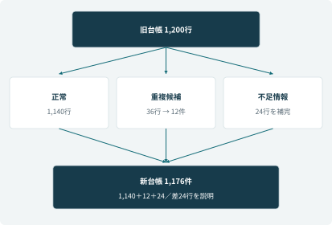

# MIG-001　移行計画書

[文書一覧](README.md)｜[ケースブック](../BOOK.md)｜[要件追跡表](07-traceability.md)

| 管理項目 | 内容 |
| --- | --- |
| 案件名 | コントソ家電 アフターサービス業務改善 |
| 文書番号・版 | MIG-001 / 1.0 |
| 編集基準日 | 2026年10月25日 |
| 作成責任 | 岡本葵／IT、小林航 |
| レビュー責任 | 高橋隆・青木莉子 |
| 本ケースでの承認責任 | 松田恵理／続行・延期の判断 |
| 基準となる工程 | 2026年5月10日の切替と5月11日の6人試行 |
| 文書の位置付け | ケースブックと整合する学習用の設計成果物。実案件の署名・承認や実機検証の実施を証明するものではない |

本書の会社・人物・データは架空である。本文で決めた業務条件を設計書として具体化し、画面ID・処理ID・制約・試験条件を補っている。追加した設計値も本ケースの仕様であり、製品既定値や実在企業の規程ではない。

## 文書管理

| 版 | 変更内容 | 変更時に合わせて確認するもの |
| --- | --- | --- |
| 1.0 | 完成版ケースブックを基準に成果物化 | 要件、外部設計、内部設計、試験、移行、運用、用語・IDの整合 |

変更はCR番号で起票し、影響する要件ID・画面ID・処理ID・試験IDを追記する。過去の承認済み版を上書きして承認の根拠を消さない。

## 1. 移行対象・対象外・移行方式

| 項目 | 定義 |
| --- | --- |
| 対象 | 初期対象製品の旧案件台帳1,200行、未完了作業、必要な外部ID・担当・期限 |
| 対象外 | 受注・在庫・予約の正本の全面移行、会話全文の無条件複写 |
| 方式 | 旧対象台帳を凍結し、確定した変換で投入。受付入口は継続し差分を記録 |
| 移行キー | sourceSystem＋拠点コード＋旧番号。氏名だけをキーにしない |
| 照合責任 | ITが機械照合、青木が品質確認、高橋が業務照合、松田が続行判断 |
| 移行完了 | 件数差の説明、旧新対応、未完了案件の責任、凍結後差分が確認済み |

## 2. データ変換・クレンジング仕様

| 区分 | 元件数 | 処置 | 移行先件数・条件 |
| --- | --- | --- | --- |
| 正常 | 1,140 | キー・日付・関連を変換 | 1,140件 |
| 重複候補 | 36 | 12グループを業務確認し統合 | 12件。旧36行の対応は全て保持 |
| 必須情報不足 | 24 | 担当が証拠を確認して補完 | 24件。推測で担当・期限を埋めない |
| 合計 | 1,200 | 不要重複24行を除外 | 1,176件 |

| 旧項目・問題 | 移行先・変換規則 | 承認・拒否条件 |
| --- | --- | --- |
| 拠点内番号 | MigrationMapから新Caseへ関連 | 同じ拠点内で重複なら保留 |
| 顧客名 | CustomerReference候補 | 連絡先・所有機・案件を合わせて本人を確認 |
| 製品名・型番 | productId、modelNumber | 別型番への類似一致で確定しない |
| 対応中 | Case状態、修理状態、次作業へ分解 | 修理番号と実際の作業を業務担当が確認 |
| 備考の担当・期限 | ownerTeam、ownerUser、dueAt | 未完了で不明なら移行保留 |
| 日付・文字コード | 日付の意味に応じJST暦日／UTC時刻 | 欠落、桁落ち、境界日、文字化けを確認 |
| 修理番号・予約番号 | RepairRequestとWorkOrderReference | 正本と突合し希望を予約へ変換しない |

統合前のスナップショット、変換版、業務判断者・理由を保存する。金額・費用負担の確定値は、古い備考の自由文から自動生成しない。

## 3. 事前リハーサルと開始条件

移行対象の抽出条件を固定し、同じ抽出から同じ1,176件へ変換されることを確認する。所要時間は本番枠18:15～19:30に収まるかを測る。失敗行だけの再実行でも新Caseが増えないよう旧新対応を使う。

| 開始条件 | 確認者 | 証跡 |
| --- | --- | --- |
| 対象・変換・統合が承認済み | 高橋・青木 | 36行の統合判断、24行の補完結果 |
| ソリューション・依存コネクタ・権限をテスト済み | 岡本 | 構成版、接続、回帰試験 |
| バックアップと復旧手順を確認 | 岡本 | 復旧点、権限、復旧後の外部照合手順 |
| 差分受付・担当・連絡経路が準備済み | 高橋 | 差分受付票、フォームID管理、当番表 |
| 重大条件と軽微残課題を確認済み | 青木 | 重大24件と5月8日までの再確認 |

## 4. 当日の実行計画

| 時刻 | 作業・責任者 | 完了条件 | 中断・延期条件 |
| --- | --- | --- | --- |
| 5/10 18:00 | 高橋：旧対象台帳を更新凍結 | 抽出点、未完了一覧、差分受付開始を記録 | 凍結できない、入口差分を追えない |
| 18:15 | 岡本：確定変換で投入 | 投入件数・拒否行・旧新対応を保存 | 想定外拒否、重複、権限不備 |
| 19:30 | 青木：機械照合 | キー・件数・状態・金額・外部関連が一致 | 説明不能な差異 |
| 20:00 | 高橋：業務照合 | 未完了の担当・期限・次作業が追える | 担当不在、誤った保証・予約状態 |
| 21:00 | 松田：続行／延期判断 | 判断と根拠、残課題、翌朝責任者を記録 | 未照合の更新があるなら旧運用を継続 |
| 5/11開始前 | 岡本・高橋：差分反映と確認 | 受付ID単位で反映済み、残件0 | 二重処理、取りこぼし、結果不明の未引継ぎ |
| 5/11 9:00 | 高橋：受付6人の試行開始 | 実権限で確認、既存窓口も利用可 | 重大な誤実行・境界違反 |

## 5. 凍結後差分の扱い

Webフォームは停止しない。受信時刻とフォーム受付IDを保持し、抽出点以前・以後を区別する。差分受付票にも一意な仮番号を付け、後からフォーム番号との対応を確認する。

差分投入は受付IDによる冪等処理とする。処理中に新しい受付が来るため、開始前の突合で使う最終受信点を固定し、それより後は通常の新運用へ流す。境界を二つの処理が同時に担当しない。拒否行を「処理済み件数」へ含めない。

## 6. 照合表

| 照合ID | 確認内容 | 合格条件 |
| --- | --- | --- |
| REC-01 | 元1,200行の行き先 | 1,176案件または承認統合元へ全件対応 |
| REC-02 | 内部・表示キー | 重複・孤立参照0件 |
| REC-03 | 状態別件数 | 承認した変換表と一致 |
| REC-04 | 未完了の担当・期限・次作業 | 欠落0件、既存担当が理解できる |
| REC-05 | 外部受付・予約・引当 | 正本のID・状態と一致、重複作成なし |
| REC-06 | 金額・保証・購入日 | 確定値と未確定を混同せず境界日が一致 |
| REC-07 | 差分受付 | 固定した受信点まで反映・拒否理由を説明 |

## 7. 切戻しと再開

1. 新規の自動更新を止め、既存窓口・代替受付へ案内する。
2. 切替後の実行要求を外部受付・引当・予約と照合する。Unknownを未実行と決めつけない。
3. 成立済みの外部処理を残し、旧運用へ新旧ID・次担当・期限を渡す。再入力で再登録しない。
4. 互換性を確認した前版へ戻し、台帳の新しい行や監査を消さない。
5. 差分と残件を処理し、原因修正・重大条件の回帰・業務確認後に再開を審査する。

## 8. 段階導入と業務引渡し

5月11日の6人試行、6月1日の公開FAQ10%、7月1日の三製品カテゴリ展開は、それぞれ公開境界・教育・実績を確認して広げる。初回の成功だけで全利用者へ一括展開しない。

引渡しには操作説明、一次回答シート、当番表、障害手順、未完了一覧、構成版、連絡窓口を含む。受付は訂正と留保、SVは未引受けとUnknown、ITは停止・照合・復旧、品質保証は規約改訂を実演できることを完了条件とする。
